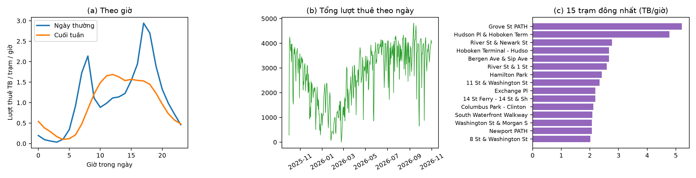
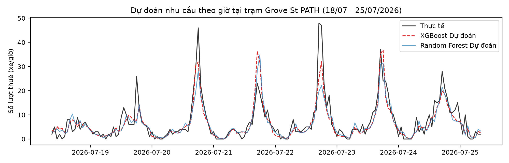

# BÁO CÁO TIẾN ĐỘ BÀI TẬP LỚN (GIỮA KỲ)

**Đề tài:** Dự đoán nhu cầu thuê xe đạp tại từng trạm trong thành phố  
**Học phần:** 20261 - Nhập môn Học máy và Khai phá dữ liệu  
**Nhóm thực hiện:** Nhóm 4  
**Hệ thống dữ liệu:** Citi Bike - Phân hệ Jersey City (10/2025 – 10/2026)  

---

## 1. Mô tả bài toán

Hệ thống xe đạp công cộng thường xuyên gặp phải tình trạng trạm hết xe vào giờ cao điểm sáng/chiều hoặc trạm đầy chỗ trả xe tại các khu văn phòng, trung tâm thương mại. Hiện tượng này bắt nguồn từ sự biến động mạnh mẽ của nhu cầu di chuyển theo khung giờ trong ngày, theo ngày làm việc so với cuối tuần và giữa các vị trí địa lý khác nhau. Nếu dự đoán chính xác số lượt thuê xe tại từng trạm theo từng khung giờ trong tương lai, đơn vị vận hành có thể chủ động điều phối xe tải chuyên chở (rebalancing) trước khi tình trạng thiếu hụt hoặc tắc nghẽn trạm xảy ra.

Nhóm phát biểu bài toán dưới dạng **Hồi quy có giám sát (Supervised Regression)**:
- **Đầu vào ($X$):** Một cặp $(\text{trạm } s, \text{khung giờ } t)$ cùng tổ hợp các đặc trưng:
  - *Thời gian:* Giờ trong ngày, thứ trong tuần, ngày trong tháng, tháng trong năm, mùa vụ, cờ ngày lễ liên bang Hoa Kỳ, cờ giờ cao điểm, các biến mã hóa chu kỳ tuần hoàn $\sin/\cos$.
  - *Không gian & Trạm:* Tọa độ địa lý (vĩ độ, kinh độ), mức độ hoạt động lịch sử trung bình của trạm.
  - *Độ trễ lịch sử (Lag features):* Nhu cầu 1 giờ trước ($t-1$), 2 giờ trước ($t-2$), cùng giờ ngày hôm trước ($t-24$) và trung bình trượt 3 giờ gần nhất.
- **Đầu ra ($y$):** Số lượt thuê xe bắt đầu tại trạm $s$ trong khung giờ $t$ (`demand`), là một số nguyên không âm ($\ge 0$).
- **Phương pháp đánh giá:** Mô hình được đánh giá định lượng bằng 3 chỉ số: **MAE** (Mean Absolute Error), **RMSE** (Root Mean Squared Error) và **$R^2$ Score** (Hệ số xác định).
- **Nguyên tắc phân chia dữ liệu:** Toàn bộ tập dữ liệu được phân chia nghiêm ngặt theo **dòng thời gian (Time-based Split)**: mô hình chỉ học từ dữ liệu quá khứ và dự đoán cho các tháng tiếp theo nhằm tránh triệt để hiện tượng rò rỉ dữ liệu tương lai (Look-ahead bias / Data leakage).

---

## 2. Các tập dữ liệu

### 2.1. Nguồn dữ liệu & Tiền xử lý
Nhóm sử dụng dữ liệu chuyến đi công khai của hệ thống xe đạp Citi Bike ([citibikenyc.com/system-data](https://citibikenyc.com/system-data)). Để tối ưu hóa tài nguyên tính toán và đảm bảo mô hình có thể huấn luyện nhanh chóng, lặp lại thực nghiệm mượt mà trên môi trường máy tính cá nhân (local), nhóm lựa chọn dữ liệu của **phân hệ Jersey City (các tệp có tiền tố `JC-`)** trong **13 tháng gần nhất (từ tháng 10/2025 đến tháng 10/2026)**. Dữ liệu khu vực Manhattan với hàng chục triệu chuyến mỗi năm sẽ được cân nhắc mở rộng ở giai đoạn cuối kỳ.

Mỗi bản ghi thô đại diện cho một lượt thuê xe với 13 trường thông tin: mã chuyến đi (`ride_id`), loại xe (`rideable_type`), thời điểm bắt đầu/kết thúc (`started_at`, `ended_at`), tên và mã định danh trạm đi/đến, tọa độ địa lý trạm đi/đến, và loại khách hàng (`member` - hội viên năm hoặc `casual` - khách lẻ).

- **Thu thập dữ liệu:** Tải tự động 13 tệp nén từ máy chủ AWS S3 (`JC-202510` đến `JC-202610`). Tổng số chuyến đi thô thu thập được là **1,083,538 chuyến**.
- **Chuẩn hóa lược đồ (Schema Normalization):** Đồng bộ hóa các tên cột và kiểu dữ liệu thời gian về định dạng chuẩn `datetime64[ns]`.
- **Làm sạch dữ liệu:**
  - Loại bỏ các chuyến đi có thời lượng bất thường: dưới 60 giây (thao tác nhầm hoặc đổi xe lỗi) hoặc kéo dài quá 24 giờ (ngoại lai).
  - Loại bỏ các bản ghi khuyết thiếu trạm đi, tọa độ hoặc trạm bảo dưỡng/thử nghiệm (`test`, `repair`, `depot`).
  - Lọc tọa độ địa lý trong phạm vi không gian Jersey City ($40.60 \le \text{lat} \le 40.85$ và $-74.15 \le \text{lon} \le -73.90$).
  - Chỉ giữ lại các trạm có hoạt động đáng kể ($\ge 100$ chuyến).
  - *Kết quả sau làm sạch:* Giữ lại **1,082,913 chuyến đi hợp lệ** (loại bỏ 625 chuyến ngoại lai) trên mạng lưới **114 trạm** hoạt động.

### 2.2. Tổng hợp theo [Trạm × Khung giờ]
Dữ liệu chuyến đi được làm tròn thời gian về đầu giờ (`floor('h')`), đếm số lượng chuyến khởi hành theo từng trạm và từng giờ.
- **Kỹ thuật Lưới thời gian thực tế (`first_seen` Grid):** Để tránh làm phình số 0 giả tạo cho những khoảng thời gian trước khi trạm được lắp đặt, nhóm xác định thời điểm bắt đầu xuất hiện của từng trạm (`first_seen`) và chỉ tạo lưới thời gian đầy đủ từ ngày trạm bắt đầu hoạt động. Những khung giờ không có chuyến phát sinh được điền giá trị `demand = 0`.
- **Kích thước dataset sau tổng hợp:** Đạt **1,023,828 mẫu** `[Trạm × Giờ]`.

### 2.3. Khám phá và phân tích đặc trưng dữ liệu (EDA)
- **Đặc điểm biến mục tiêu (`demand`):** Phân bố lệch phải rõ rệt với **60.0%** số mẫu mang giá trị bằng 0 (khung giờ vắng khách, đặc biệt ban đêm từ 01:00 đến 05:00); nhu cầu trung bình toàn mạng lưới đạt **1.058 lượt/trạm/giờ**, giá trị cao nhất ghi nhận là **69 lượt/giờ**.
- **Hành vi người dùng:** **76.3%** chuyến đi được thực hiện bởi Hội viên năm (`member`) và **23.7%** bởi Khách lẻ (`casual`). Thời lượng chuyến đi có giá trị trung vị là **6.2 phút**, phản ánh xe đạp công cộng chủ yếu phục vụ nhu cầu kết nối cự ly ngắn đến các đầu mối giao thông công cộng.

  
*Hình 1. (a) Lượt thuê trung bình theo giờ, (b) Tổng lượt thuê theo ngày (10/2025 - 10/2026), (c) Top 15 trạm có nhu cầu cao nhất.*

**Ba quy luật cốt lõi thể hiện trên Hình 1:**
1. **Theo giờ trong ngày (Hình 1a):** Ngày thường xuất hiện rõ rệt 2 đỉnh cao điểm vào lúc **08:00 sáng** và **18:00 chiều** (phục vụ người dân đi làm và tan tầm). Ngược lại, ngày cuối tuần chỉ có một đỉnh thoai thoải duy nhất tập trung vào giữa ngày (12:00 - 16:00).
2. **Theo mùa vụ & thời gian (Hình 1b):** Nhu cầu tăng trưởng mạnh mẽ và đạt đỉnh vào các tháng mùa Hè - Thu ấm áp (tháng 5 đến tháng 9); sụt giảm rõ rệt vào mùa Đông (tháng 12 đến tháng 2) do thời tiết giá rét và tuyết rơi.
3. **Theo vị trí trạm (Hình 1c):** Nhu cầu tập trung cao độ tại các trạm kết nối trực tiếp với hệ thống tàu điện ngầm PATH sang New York. Trong đó, trạm **Grove St PATH** dẫn đầu toàn thành phố với trung bình gần **6.8 lượt thuê/giờ**, bỏ xa các trạm xếp phía sau như Hudson Pl & Hoboken Terminal, River St & 1 St, Hamilton Park.

### 2.4. Kỹ thuật tạo đặc trưng (Feature Engineering)
Với mỗi mẫu `(trạm, giờ)`, nhóm xây dựng hệ thống **18 đặc trưng**:
1. *Thời gian cơ bản:* `hour`, `dayofweek`, `day`, `month`, `is_weekend`.
2. *Ngày lễ & Giờ cao điểm:* `is_holiday` (dựa trên danh mục ngày lễ liên bang Mỹ), `is_rush` (cờ đánh dấu khung giờ 7-9h và 17-19h của ngày thường), `season` (mùa trong năm).
3. *Mã hóa chu kỳ tuần hoàn:* `hour_sin`, `hour_cos`, `month_sin`, `month_cos`.
4. *Không gian:* Tọa độ trạm `lat`, `lon`.
5. *Target Encoding trạm:* `station_mean` (nhu cầu trung bình của trạm - chỉ được tính toán trên tập Huấn luyện để chống rò rỉ dữ liệu sang tập Kiểm tra).
6. *Đặc trưng độ trễ chuỗi thời gian (Lag features):* Nhu cầu 1 giờ trước (`demand_lag_1h`), 2 giờ trước (`demand_lag_2h`), cùng khung giờ ngày hôm trước (`demand_lag_24h`) và trung bình trượt 3 giờ trước (`rolling_mean_3h`).

---

## 3. Kết quả thí nghiệm hiện thời

### 3.1. Phân chia dữ liệu và thiết lập mô hình
- Dữ liệu được chia theo dòng thời gian với tỷ lệ **70% Huấn luyện (Train)** và **30% Kiểm tra (Test)**:
  - **Tập Train:** 714,764 mẫu (từ 01/10/2025 đến 11/07/2026).
  - **Tập Test:** 306,328 mẫu (từ 11/07/2026 đến 31/10/2026).
- Nhóm xây dựng và so sánh **5 mô hình**:
  1. **Mô hình cơ sở (Baseline):** Dự đoán bằng trung bình lịch sử theo tổ hợp `(trạm, giờ, ngày thường/cuối tuần)`.
  2. **Linear Regression:** Áp dụng thiết kế One-Hot cho `hour`, `dayofweek`, `season` để học các quan hệ phi tuyến.
  3. **Decision Tree Regressor:** Cây quyết định đơn lẻ (`max_depth = 12`, `min_samples_leaf = 50`).
  4. **Random Forest Regressor:** Rừng ngẫu nhiên gồm 100 cây (`max_depth = 15`, `min_samples_leaf = 20`, `max_samples = 0.3`).
  5. **XGBoost Regressor:** Thuật toán Gradient Boosting tối ưu cao (`n_estimators = 150`, `learning_rate = 0.08`, `max_depth = 6`, `subsample = 0.8`).

### 3.2. Bảng kết quả so sánh định lượng
Bảng 1 tóm tắt kết quả đánh giá độc lập của 5 mô hình trên 306,328 mẫu của tập kiểm tra.

**Bảng 1. Kết quả thực nghiệm trên tập kiểm tra (11/07/2026 đến 31/10/2026)**

| Mô hình | MAE (lượt/giờ) | RMSE (lượt/giờ) | $R^2$ Score | Thời gian huấn luyện (s) |
| :--- | :---: | :---: | :---: | :---: |
| **Mô hình cơ sở (TB lịch sử trạm, giờ, cuối tuần)** | 0.9368 | 1.8394 | 0.4256 | 0.00s |
| **Linear Regression** | 0.9439 | 1.6652 | 0.5292 | 1.21s |
| **Decision Tree (max_depth = 12)** | 0.8768 | 1.5696 | 0.5817 | 8.45s |
| **Random Forest (100 cây)** | **0.8609** | 1.5154 | 0.6101 | 95.85s |
| **XGBoost Regressor (Tối ưu)** | 0.8726 | **1.4861** | **0.6251** | **19.54s** |

### 3.3. Phân tích chuyên sâu kết quả thực nghiệm

1. **So sánh hiệu năng giữa các mô hình:**
   - **XGBoost Regressor** đạt kết quả tổng thể vượt trội nhất trên tập kiểm tra với **RMSE thấp nhất (1.4861)** và **$R^2$ cao nhất (0.6251)**, cải thiện vượt bậc so với mô hình cơ sở ($\Delta R^2 \approx +0.20$).
   - **Random Forest** đạt mức sai số tuyệt đối trung bình tốt nhất (**MAE = 0.8609**). Tuy nhiên, thời gian huấn luyện của Random Forest lâu hơn gần 5 lần so với XGBoost (95.85 giây so với 19.54 giây). Do đó, nhóm lựa chọn **XGBoost Regressor** làm mô hình nòng cốt để đóng gói triển khai web demo.
   - **Linear Regression** đạt $R^2 = 0.5292$, kém hơn đáng kể so với các mô hình cây do không thể bắt trọn vẹn các tương tác phi tuyến phức tạp giữa không gian trạm và thời gian.

2. **Độ quan trọng của đặc trưng (Feature Importance):**
   - Theo mô hình XGBoost, các đặc trưng độ trễ chuỗi thời gian đóng vai trò quyết định hàng đầu:
     - `demand_lag_1h` (nhu cầu 1 giờ trước): đóng góp **24.73%**.
     - `demand_lag_24h` (nhu cầu cùng giờ hôm qua): đóng góp **23.44%**.
     - `rolling_mean_3h` (trung bình trượt 3 giờ): đóng góp **9.90%**.
     - `station_mean` (lưu lượng trung bình trạm): đóng góp **6.55%**.
     - `is_rush` (khung giờ cao điểm): đóng góp **6.19%**.
   - Việc bổ sung các đặc trưng độ trễ (Lag features) ngay từ giai đoạn giữa kỳ đã giúp các mô hình bám sát biến động nhu cầu thời gian thực hơn rất nhiều so với chỉ dùng đặc trưng lịch đơn thuần.

3. **Phân tích sai số theo từng trạm:**
   - Sai số dự báo có xu hướng tập trung ở các trạm có lưu lượng lớn:
     - Tại trạm đông nhất **Grove St PATH** (`JC115`), nhu cầu thực tế trung bình là 6.78 lượt/giờ, sai số MAE của XGBoost là **2.30 lượt/giờ**.
     - Tại trạm **Hudson Pl & Hoboken Terminal** (`HB107`), nhu cầu trung bình 4.78 lượt/giờ, MAE là **2.56 lượt/giờ**.
     - Tại các trạm dân cư lưu lượng thấp, MAE giảm xuống dưới **0.5 lượt/giờ**.

  
*Hình 2. Nhu cầu thực tế và dự đoán của XGBoost vs Random Forest tại trạm Grove St PATH trong 1 tuần mẫu.*

Nhận xét từ Hình 2: Mô hình XGBoost và Random Forest bám rất sát nhịp điệu của các đỉnh cao điểm hàng ngày. Ở một số đỉnh đột biến cực đại, dự đoán có phần thận trọng hơn thực tế do mô hình giữa kỳ chưa được tích hợp dữ liệu thời tiết thực tế (nắng ấm đột ngột làm tăng vọt nhu cầu) và các sự kiện đô thị bất thường.

### 3.4. Triển khai ứng dụng Web Demo (Streamlit)
Nhóm đã hoàn thiện giao diện ứng dụng demo tại tệp [app.py](file:///d:/Khai%20ph%C3%A1%20d%E1%BB%AF%20li%E1%BB%87u/app.py):
- **Bản đồ số tương tác (Pydeck):** Hiển thị toàn bộ 114 trạm xe đạp tại Jersey City; người dùng click vào trạm để xem thông tin và chọn vị trí.
- **Form điều khiển & Nhập tay thời tiết:** Cho phép chọn ngày giờ dự báo kèm các thanh trượt nhập tay nhiệt độ, lượng mưa, tốc độ gió để khảo sát độ nhạy của nhu cầu.
- **Hiển thị trực quan:** Cung cấp số lượt xe dự kiến tức thì, cảnh báo điều phối xe (`Đủ xe` hoặc `Cần tiếp thêm xe`) và biểu đồ đường dự báo liên tục trong 24 giờ tiếp theo của trạm.

---

## 4. Các bước tiếp theo cho báo cáo cuối kỳ

1. **Tích hợp tự động dữ liệu thời tiết theo giờ (Hourly Weather API):**
   - Thu thập tự động dữ liệu thời tiết lịch sử theo giờ từ Open-Meteo API (nhiệt độ, lượng mưa thực tế, độ ẩm, tốc độ gió) để ghép nối trực tiếp vào tập huấn luyện, thay thế cho cơ chế nhập tay hiện tại, nhằm giảm triệt để sai số tại các đỉnh nhu cầu cực đại.
2. **Tinh chỉnh siêu tham số chuyên sâu (Hyperparameter Tuning):**
   - Sử dụng kỹ thuật kiểm định chéo chuỗi thời gian (`TimeSeriesSplit`) kết hợp thư viện **Optuna** hoặc **RandomizedSearchCV** để tối ưu hóa sâu các tham số của XGBoost (`max_depth`, `learning_rate`, `colsample_bytree`, `reg_lambda`) và Random Forest.
3. **Thử nghiệm mô hình nâng cao & Xử lý biến mục tiêu:**
   - Thử nghiệm các biến thể Gradient Boosting khác như **LightGBM**, **CatBoost** và kỹ thuật Ensemble/Blending.
   - Áp dụng phép biến đổi $\log(1 + y)$ hoặc hàm mất mát phân phối Poisson (`objective='count:poisson'`) để tối ưu hóa tốt hơn trên tập dữ liệu có tỷ lệ số 0 cao (60.0%).
4. **Nâng cấp tính năng Web Demo:**
   - Kết nối dữ liệu luồng trực tiếp từ API thời tiết và GBFS feed của Citi Bike để hiển thị trạng thái số lượng xe sẵn có tại trạm theo thời gian thực.
   - Xây dựng thuật toán tối ưu hóa tuyến đường điều phối xe tải (Rebalancing Route Optimization) giữa các trạm thừa và trạm thiếu.
5. **Mở rộng phạm vi nghiên cứu & Hoàn thiện báo cáo:**
   - Đánh giá khả năng mở rộng thuật toán sang dữ liệu toàn bộ thành phố New York (NYC/Manhattan) và hoàn thiện báo cáo đồ án cuối kỳ kèm slide thuyết trình.
