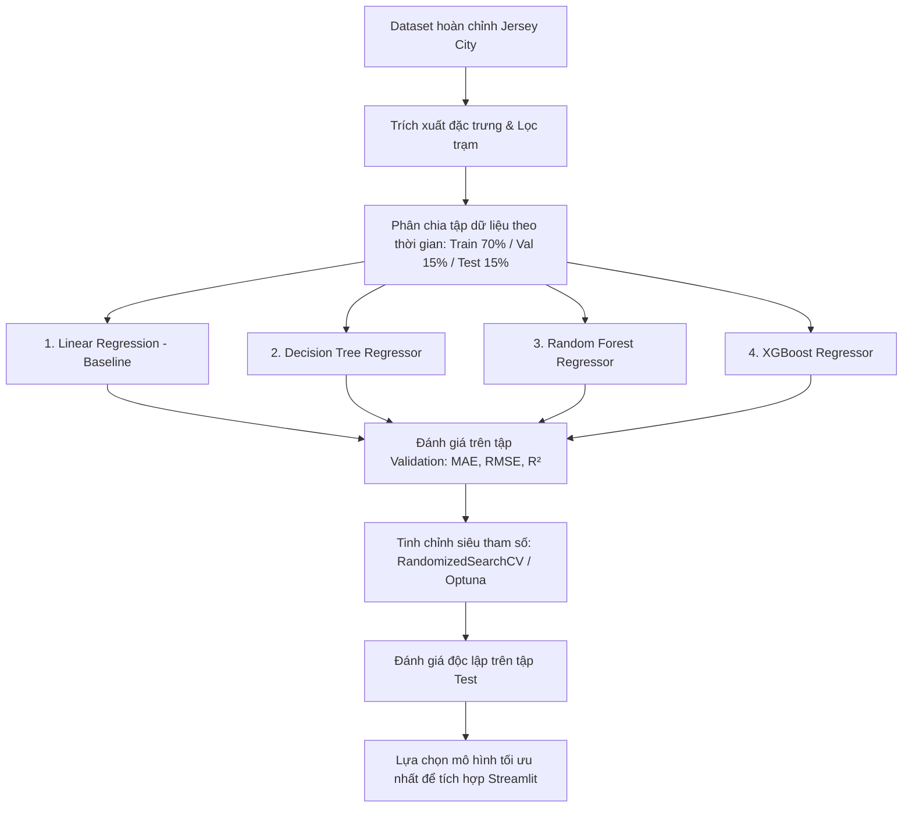
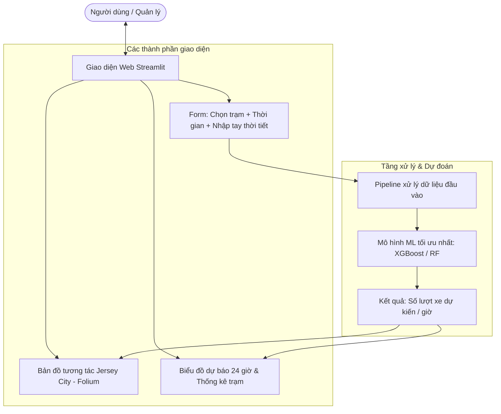
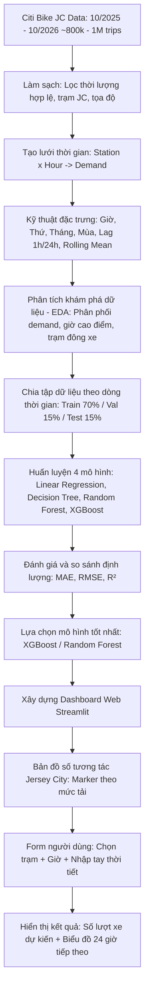

# BÁO CÁO ĐỀ XUẤT ĐỀ TÀI PROJECT
## MÔN HỌC: KHAI PHÁ DỮ LIỆU & MACHINE LEARNING

---

> **Tên đề tài:** Dự đoán nhu cầu thuê xe đạp công cộng tại các trạm theo thời gian sử dụng Machine Learning  
> **Khu vực nghiên cứu:** Thành phố Jersey City (Tiểu bang New Jersey - thuộc hệ thống Citi Bike)  
> **Nguồn dữ liệu:** Citi Bike Trip Histories (Tập dữ liệu Jersey City với tiền tố `JC-`)  
> **Lĩnh vực:** Smart Transportation / Smart City / Khai phá dữ liệu & Dự báo chuỗi thời gian  
> **Giai đoạn báo cáo:** Báo cáo Đề xuất Đề tài (Giữa kỳ)  

---

## MỤC LỤC
1. [Giới thiệu đề tài](#1-giới-thiệu-đề-tài)
   - [1.1. Lý do chọn đề tài](#11-lý-do-chọn-đề-tài)
   - [1.2. Mục tiêu đề tài](#12-mục-tiêu-đề-tài)
   - [1.3. Phạm vi đề tài & Lý do chọn Jersey City](#13-phạm-vi-đề-tài--lý-do-chọn-jersey-city)
2. [Cơ sở lý thuyết](#2-cơ-sở-lý-thuyết)
   - [2.1. Tổng quan về Machine Learning](#21-tổng-quan-về-machine-learning)
   - [2.2. Bài toán dự đoán nhu cầu thuê xe](#22-bài-toán-dự-đoán-nhu-cầu-thuê-xe)
   - [2.3. Các thuật toán sử dụng](#23-các-thuật-toán-sử-dụng)
   - [2.4. Các phương pháp đánh giá](#24-các-phương-pháp-đánh-giá)
3. [Dữ liệu](#3-dữ-liệu)
   - [3.1. Giới thiệu nguồn dữ liệu Citi Bike (Jersey City)](#31-giới-thiệu-nguồn-dữ-liệu-citi-bike-jersey-city)
   - [3.2. Cấu trúc dữ liệu ban đầu](#32-cấu-trúc-dữ-liệu-ban-đầu)
   - [3.3. Xây dựng dataset cho bài toán dự đoán](#33-xây-dựng-dataset-cho-bài-toán-dự-đoán)
   - [3.4. Các đặc trưng sử dụng (Phân kỳ Giữa kỳ & Cuối kỳ)](#34-các-đặc-trưng-sử-dụng-phân-kỳ-giữa-kỳ--cuối-kỳ)
4. [Tiền xử lý dữ liệu](#4-tiền-xử-lý-dữ-liệu)
   - [4.1. Kiểm tra dữ liệu](#41-kiểm-tra-dữ-liệu)
   - [4.2. Làm sạch dữ liệu](#42-làm-sạch-dữ-liệu)
   - [4.3. Xử lý thời gian](#43-xử-lý-thời-gian)
   - [4.4. Tổng hợp dữ liệu theo trạm](#44-tổng-hợp-dữ-liệu-theo-trạm)
   - [4.5. Mã hóa biến phân loại](#45-mã-hóa-biến-phân-loại)
   - [4.6. Chuẩn hóa dữ liệu](#46-chuẩn-hóa-dữ-liệu)
   - [4.7. Chia tập dữ liệu theo dòng thời gian](#47-chia-tập-dữ-liệu-theo-dòng-thời-gian)
5. [Phân tích và khám phá dữ liệu (EDA)](#5-phân-tích-và-khám-phá-dữ-liệu-eda)
6. [Xây dựng mô hình Machine Learning](#6-xây-dựng-mô-hình-machine-learning)
7. [Đánh giá và so sánh](#7-đánh-giá-và-so-sánh)
8. [Xây dựng hệ thống demo (Jersey City Interactive Map)](#8-xây-dựng-hệ-thống-demo-jersey-city-interactive-map)
9. [Kết luận và Kế hoạch thực hiện](#9-kết-luận-và-kế-hoạch-thực-hiện)
10. [Tài liệu tham khảo](#10-tài-liệu-tham-khảo)
- [Phụ lục](#phụ-lục)
- [Tóm tắt Flow toàn bộ Project](#tóm-tắt-flow-toàn-bộ-project)

---

## 1. Giới thiệu đề tài

### 1.1. Lý do chọn đề tài
- **Biến động nhu cầu theo không gian và thời gian:** Hệ thống xe đạp công cộng là phương tiện giao thông xanh, giải quyết bài toán "dặm cuối" (last-mile) kết nối với hệ thống giao thông công cộng. Nhu cầu thuê xe tại các trạm thay đổi liên tục theo khung giờ trong ngày (đặc biệt là giờ cao điểm sáng và chiều), theo ngày làm việc so với cuối tuần, và biến động theo từng khu vực địa lý.
- **Tình trạng mất cân bằng tại trạm (Station Imbalance):** Các trạm tại khu dân cư đông đúc hoặc đầu mối giao thông (như ga tàu điện ngầm ngõ vào thành phố) thường xuyên bị thiếu xe vào buổi sáng, trong khi các trạm tại khu văn phòng, trung tâm thương mại lại bị đầy trạm (không còn chỗ trả xe).
- **Ý nghĩa quản lý và điều phối:** Dự đoán chính xác nhu cầu giúp các đơn vị quản lý chủ động lên kế hoạch phân bổ xe (rebalancing), tối ưu hóa nguồn lực nhân sự, phương tiện chuyên chở và nâng cao trải nghiệm của người dùng.
- **Tính khả thi của Machine Learning:** Với khối lượng dữ liệu lịch sử các chuyến đi được ghi nhận liên tục, các mô hình Học máy có thể tự động học các quy luật chu kỳ tuần hoàn để đưa ra dự báo chính xác cao.

### 1.2. Mục tiêu đề tài
- **Thu thập & Khám phá dữ liệu:** Khai phá dữ liệu lịch sử chuyến đi của hệ thống xe đạp công cộng tại Jersey City.
- **Xác định các yếu tố tác động:** Phân tích ảnh hưởng của thời gian (giờ, thứ, ngày, tháng, mùa) và vị trí địa lý trạm đến nhu cầu thuê xe.
- **Huấn luyện mô hình Machine Learning:** Xây dựng mô hình hồi quy dự đoán số lượt thuê xe tại từng trạm theo từng khung giờ (`Hourly Demand`).
- **So sánh mô hình:** Thử nghiệm, tinh chỉnh và so sánh hiệu năng giữa 4 thuật toán: Linear Regression, Decision Tree, Random Forest, XGBoost.
- **Trực quan hóa không gian địa lý:** Xây dựng bản đồ phân bố mật độ trạm và nhu cầu thực tế trên nền bản đồ số.
- **Xây dựng ứng dụng Demo (Streamlit):** Thiết kế dashboard tương tác cho phép chọn trạm trên bản đồ Jersey City, xem dự báo nhu cầu trong 24 giờ tiếp theo và hỗ trợ form nhập tay điều kiện thời tiết để quan sát sự thay đổi của nhu cầu.

### 1.3. Phạm vi đề tài & Lý do chọn Jersey City
- **Đối tượng nghiên cứu:** Nhu cầu thuê xe đạp tại các trạm xe đạp công cộng (số lượt khởi hành/giờ tại mỗi trạm).
- **Khu vực dữ liệu:** Thành phố **Jersey City (New Jersey, Hoa Kỳ)**.
- **Lý do lựa chọn Jersey City thay vì New York City (NYC):**
  > [!IMPORTANT]  
  > **Tối ưu hóa tài nguyên phần cứng cho môi trường Local:**
  > 1. **Kích thước dữ liệu toàn bộ New York City quá lớn:** NYC có hơn 2,000 trạm, mỗi tháng phát sinh từ 3.5 đến 4.5 triệu chuyến đi. Toàn bộ 12 tháng dữ liệu NYC lên tới 40 - 50 triệu bản ghi thô (hơn 10GB nén, khi giải nén và xử lý vượt quá 30GB RAM), hoàn toàn không khả thi để huấn luyện và tinh chỉnh lặp lại trên máy tính cá nhân/laptop cá nhân.
  > 2. **Jersey City có quy mô hoàn hảo cho môi trường máy tính cá nhân:** 
  >    - Jersey City là một phân vùng độc lập thuộc hệ thống Citi Bike, được cung cấp riêng dưới tiền tố `JC-`.
  >    - Mỗi tháng Jersey City có khoảng **40,000 đến 110,000 chuyến đi**, dung lượng nén chỉ khoảng **1 - 3 MB/tháng** (giải nén khoảng **15 - 30 MB/tháng**).
  >    - Tổng 12 tháng chỉ khoảng **800,000 - 1,000,000 chuyến đi thô** (~25MB zip).
  >    - Sau khi tổng hợp theo lưới `[Trạm × Giờ]`, tập dữ liệu chỉ vào khoảng **400,000 - 600,000 dòng**, bộ nhớ RAM tiêu thụ dưới 1GB, thời gian huấn luyện mô hình Random Forest/XGBoost chỉ mất từ **10 - 45 giây** trên máy local, cho phép thử nghiệm và tinh chỉnh siêu tham số thoải mái mà không lo tràn RAM.
  > 3. **Tính chất đô thị đầy đủ và khoa học:** Jersey City sở hữu mạng lưới khoảng 80 - 100 trạm, bao gồm đầy đủ các khu vực văn phòng ven sông Hudson (Exchange Place, Newport), đầu mối giao thông tàu điện ngầm PATH kết nối Manhattan (Grove Street, Journal Square) và khu dân cư, đảm bảo đầy đủ các quy luật di chuyển giao thông đô thị hiện đại.
- **Nguồn dữ liệu:** Citi Bike System Data (các tệp `JC-*-citibike-tripdata.csv.zip`).
- **Khoảng thời gian dữ liệu sử dụng:** **12 tháng gần nhất (Từ 10/2025 đến 10/2026)** để bắt trọn chu kỳ thời gian và 4 mùa trong năm.
- **Đơn vị dự đoán:** Từng trạm (`start_station_id`) theo từng khung giờ (1 giờ).
- **Loại bài toán:** Hồi quy (Regression).
- **Giao diện Demo:** Ứng dụng Streamlit hiển thị bản đồ tương tác Jersey City (Folium/Pydeck).

---

## 2. Cơ sở lý thuyết

### 2.1. Tổng quan về Machine Learning
- **Khái niệm:** Machine Learning (Học máy) là phân nhánh của Trí tuệ nhân tạo, cho phép hệ thống học hỏi từ dữ liệu lịch sử để tìm ra các quy luật tiềm ẩn và đưa ra quyết định hoặc dự đoán trên dữ liệu mới mà không cần lập trình các quy tắc cứng.
- **Học có giám sát (Supervised Learning):** Quá trình huấn luyện mô hình dựa trên tập dữ liệu đã có nhãn $(X, y)$, trong đó $X$ là tập các đặc trưng (features) và $y$ là nhãn mục tiêu (target).
- **Bài toán hồi quy (Regression):** Nhiệm vụ dự đoán giá trị liên tục $y \in \mathbb{R}$. Trong bài toán này, $y$ đại diện cho số lượt thuê xe tại trạm $s$ trong khung giờ $t$.
- **Quy trình xây dựng mô hình:** Thu thập dữ liệu $\rightarrow$ Tiền xử lý $\rightarrow$ Tạo đặc trưng $\rightarrow$ Phân chia dữ liệu theo chuỗi thời gian $\rightarrow$ Huấn luyện $\rightarrow$ Đánh giá $\rightarrow$ Đóng gói và triển khai.

### 2.2. Bài toán dự đoán nhu cầu thuê xe
- **Biến mục tiêu ($y$):** Số lượt xe bắt đầu chuyến đi tại trạm $s$ trong khoảng thời gian $[t, t+1)$ (lượt thuê/giờ).
- **Các nhóm yếu tố ảnh hưởng:**
  - *Thời gian:* Giờ trong ngày (cao điểm/thấp điểm), ngày trong tuần (thứ hai - chủ nhật), tháng/mùa trong năm, ngày lễ.
  - *Không gian & Vị trí:* Tọa độ trạm (kinh độ, vĩ độ), vị trí trạm (gần ga tàu điện ngầm PATH, khu văn phòng hay khu công viên).
  - *Lịch sử (Trễ):* Nhu cầu của trạm ở các giờ trước đó ($t-1, t-2$), nhu cầu cùng giờ của ngày hôm trước ($t-24$).
  - *Thời tiết:* Nhiệt độ, lượng mưa, tốc độ gió, độ ẩm.
- **Công thức tổng quát:**
  $$\hat{y}_{s, t} = f\Big(\text{StationFeatures}_s, \;\text{TemporalFeatures}_t, \;\text{HistoricalLagFeatures}_{s, t}, \;\text{WeatherFeatures}_t\Big)$$

### 2.3. Các thuật toán sử dụng

#### 2.3.1. Linear Regression (Mô hình cơ sở - Baseline)
- **Nguyên lý:** Mô hình hóa mối quan hệ giữa biến mục tiêu $y$ và các biến độc lập $X$ dưới dạng hàm tuyến tính:
  $$y = w_0 + \sum_{j=1}^{p} w_j x_j + \epsilon$$
  Sử dụng phương pháp bình phương tối thiểu (OLS) để tìm bộ trọng số $w$.
- **Ưu điểm:** Tính toán cực nhanh, dễ diễn giải ý nghĩa của các hệ số trọng số, là thước đo đối chuẩn (baseline) chuẩn mực.
- **Hạn chế:** Không học được các quan hệ phi tuyến phức tạp (ví dụ: nhiệt độ quá cao hoặc quá thấp đều làm giảm nhu cầu).

#### 2.3.2. Decision Tree Regression
- **Nguyên lý:** Phân chia không gian đặc trưng thành các vùng siêu chữ nhật độc lập bằng các câu hỏi điều kiện dạng if-else. Mỗi nút lá dự đoán bằng giá trị trung bình của các mẫu rơi vào vùng đó.
- **Ưu điểm:** Bắt được các mối quan hệ phi tuyến; trực quan; không đòi hỏi chuẩn hóa độ lớn đặc trưng.
- **Hạn chế:** Dễ bị quá khớp (overfitting), nhạy cảm với sự thay đổi nhỏ trong tập huấn luyện.

#### 2.3.3. Random Forest Regression
- **Nguyên lý:** Thuật toán học kết hợp (Ensemble Learning) dựa trên kỹ thuật Bagging. Xây dựng đồng thời hàng trăm cây quyết định trên các tập con mẫu (bootstrap sample) và tập con đặc trưng ngẫu nhiên. Kết quả dự đoán cuối cùng là giá trị trung bình của tất cả các cây:
  $$\hat{y} = \frac{1}{B}\sum_{b=1}^{B} T_b(x)$$
- **Ưu điểm:** Giảm phương sai (variance), hạn chế tối đa overfitting của cây đơn lẻ; độ chính xác cao; cung cấp chỉ số đánh giá độ quan trọng của đặc trưng.
- **Hạn chế:** Kích thước mô hình lưu trữ lớn hơn; tốn thời gian huấn luyện hơn so với cây đơn lẻ.

#### 2.3.4. XGBoost Regression (Extreme Gradient Boosting)
- **Nguyên lý:** Thuật toán Boosting tối ưu hóa hàm mục tiêu có chứa thành phần phạt độ phức tạp cây thông qua xấp xỉ Taylor bậc 2 của hàm mất mát. Các cây mới được huấn luyện tuần tự để dự đoán phần dư sai số (residual) của các cây trước đó.
- **Ưu điểm:** Hiệu năng dự đoán vượt trội trên dữ liệu dạng bảng; tích hợp sẵn kỹ thuật điều hòa $L_1$ (Lasso) và $L_2$ (Ridge) giúp chống overfitting hiệu quả; tốc độ thực thi rất nhanh nhờ tối ưu hóa phần cứng.
- **Hạn chế:** Cần tinh chỉnh nhiều siêu tham số (learning rate, max depth, subsample, colsample_bytree).

### 2.4. Các phương pháp đánh giá
Nhóm sử dụng 3 độ đo đánh giá định lượng chuẩn cho bài toán hồi quy:

1. **Mean Absolute Error (MAE):**
   $$\text{MAE} = \frac{1}{N}\sum_{i=1}^{N} |y_i - \hat{y}_i|$$
   *Ý nghĩa:* Cho biết trung bình mô hình dự đoán lệch bao nhiêu lượt thuê xe so với thực tế.

2. **Root Mean Squared Error (RMSE):**
   $$\text{RMSE} = \sqrt{\frac{1}{N}\sum_{i=1}^{N} (y_i - \hat{y}_i)^2}$$
   *Ý nghĩa:* Phạt nặng các lỗi sai lớn do có thành phần bình phương; rất quan trọng đối với các trạm có nhu cầu đột biến.

3. **Hệ số xác định ($R^2$ Score):**
   $$R^2 = 1 - \frac{\sum_{i=1}^N (y_i - \hat{y}_i)^2}{\sum_{i=1}^N (y_i - \bar{y})^2}$$
   *Ý nghĩa:* Thể hiện tỷ lệ phần trăm sự biến thiên của nhu cầu thuê xe được giải thích bởi mô hình (tiệm cận 1 là tối ưu).

---

## 3. Dữ liệu

### 3.1. Giới thiệu nguồn dữ liệu Citi Bike (Jersey City)
- **Hệ thống dữ liệu:** Citi Bike là mạng lưới chia sẻ xe đạp công cộng lớn nhất Bắc Mỹ do NYC Bike Share (Lyft) vận hành. Trong đó, hệ thống tại Jersey City (bang New Jersey) hoạt động liên thông và được chia sẻ công khai dữ liệu độc lập.
- **Nguồn tải chính thức:**
  - Trang chủ dữ liệu: [Citi Bike – System Data](https://citibikenyc.com/system-data)
  - Máy chủ lưu trữ đám mây: [Citi Bike Trip Data S3 Index](https://s3.amazonaws.com/tripdata/index.html)
- **Quy tắc định danh tệp Jersey City:**
  - Các tệp dữ liệu của Jersey City được phân biệt bằng tiền tố **`JC-`**, có cấu trúc:  
    `https://s3.amazonaws.com/tripdata/JC-YYYYMM-citibike-tripdata.csv.zip`
  - Ví dụ: `JC-202510-citibike-tripdata.csv.zip`, `JC-202511-citibike-tripdata.csv.zip`, ..., `JC-202610-citibike-tripdata.csv.zip`.
- **Quy mô dữ liệu sử dụng:**
  - **Khoảng thời gian:** **13 tháng gần nhất (10/2025 – 10/2026)** (bắt trọn 4 mùa: Thu 2025, Đông 2025-2026, Xuân 2026, Hè 2026, Thu 2026).
  - **Tổng số tệp dữ liệu:** 13 tệp nén hàng tháng (`JC-202510` đến `JC-202610`).
  - **Số lượng bản ghi chuyến đi thô:** **1,083,538 chuyến đi**.
  - **Số lượng chuyến đi hợp lệ sau làm sạch:** **1,082,913 chuyến đi** (loại bỏ 625 chuyến ngoại lai < 60s hoặc > 24h).
  - **Tỷ lệ đối tượng người dùng:** **76.3%** Hội viên thường niên (`member`), **23.7%** Khách lẻ (`casual`).
  - **Thời lượng trung vị mỗi chuyến đi:** **6.2 phút**.
  - **Số lượng trạm:** Toàn bộ mạng lưới **114 trạm** hoạt động tại Jersey City.
  - **Quy mô sau tổng hợp lưới [Trạm × Giờ]:** **1,023,828 bản ghi** (Tỷ lệ khung giờ không phát sinh chuyến: 60.0%; Nhu cầu trung bình: 1.058 xe/giờ; Nhu cầu cao nhất: 69 xe/giờ).

### 3.2. Cấu trúc dữ liệu ban đầu
Mỗi bản ghi trong tệp CSV tương ứng với 1 chuyến đi (`trip`):

| Thuộc tính | Kiểu dữ liệu | Ý nghĩa |
| :--- | :--- | :--- |
| `ride_id` | String | Mã định danh duy nhất cho từng lượt thuê |
| `rideable_type` | String | Loại phương tiện (`classic_bike`, `electric_bike`) |
| `started_at` | Datetime | Thời điểm bắt đầu chuyến đi |
| `ended_at` | Datetime | Thời điểm kết thúc chuyến đi |
| `start_station_name` | String | Tên trạm bắt đầu |
| `start_station_id` | String | Mã định danh trạm bắt đầu (ví dụ: `JC001`, `JC102`) |
| `end_station_name` | String | Tên trạm kết thúc |
| `end_station_id` | String | Mã định danh trạm kết thúc |
| `start_lat` | Float | Vĩ độ của trạm bắt đầu |
| `start_lng` | Float | Kinh độ của trạm bắt đầu |
| `end_lat` | Float | Vĩ độ của trạm kết thúc |
| `end_lng` | Float | Kinh độ của trạm kết thúc |
| `member_casual` | String | Loại khách hàng (`member` - Hội viên năm, `casual` - Khách lẻ) |

### 3.3. Xây dựng dataset cho bài toán dự đoán
Dữ liệu thô cấp độ chuyến đi được tổng hợp thành bảng dữ liệu nhu cầu theo thời gian:
$$\text{Trạm (start\_station\_id)} \times \text{Khung thời gian (từng giờ: YYYY-MM-DD HH:00:00)} \longrightarrow \text{Nhu cầu (demand)}$$

**Ví dụ dữ liệu sau tổng hợp:**

| datetime | station_id | station_name | lat | lng | demand |
| :---: | :---: | :---: | :---: | :---: | :---: |
| 2026-05-15 08:00:00 | JC005 | Grove St PATH | 40.7195 | -74.0431 | 58 |
| 2026-05-15 09:00:00 | JC005 | Grove St PATH | 40.7195 | -74.0431 | 74 |
| 2026-05-15 10:00:00 | JC005 | Grove St PATH | 40.7195 | -74.0431 | 31 |
| 2026-05-15 08:00:00 | JC012 | Newport Pkwy | 40.7287 | -74.0321 | 42 |

*Quy mô sau tổng hợp:* Khoảng 80 trạm $\times$ 24 giờ $\times$ 365 ngày $\approx$ 700,000 bản ghi (rất nhẹ nhàng cho xử lý local).

### 3.4. Các đặc trưng sử dụng (Phân kỳ Giữa kỳ & Cuối kỳ)

> [!NOTE]  
> **Kế hoạch triển khai theo 2 giai đoạn:**
> - **Giai đoạn Giữa kỳ (Hiện tại):** Tập trung huấn luyện trên các đặc trưng thời gian, vị trí trạm và đặc trưng độ trễ lịch sử. Chưa kết hợp tự động API thời tiết lịch sử vào dataset huấn luyện; trên giao diện Web Demo sẽ cung cấp form **nhập tay điều kiện thời tiết** để người dùng thử nghiệm kịch bản dự báo.
> - **Giai đoạn Cuối kỳ:** Tự động thu thập dữ liệu thời tiết lịch sử theo giờ (Open-Meteo Historical API) để ghép nối trực tiếp vào tập huấn luyện của mô hình.

#### Bảng danh mục đặc trưng:
1. **Đặc trưng thời gian (Temporal Features):**
   - Giờ trong ngày (`hour`: 0 - 23)
   - Ngày trong tuần (`day_of_week`: 0 - 6, thứ Hai đến Chủ Nhật)
   - Tháng trong năm (`month`: 1 - 12)
   - Mùa trong năm (`season`: Xuân, Hạ, Thu, Đông)
   - Phân loại ngày làm việc / cuối tuần (`is_weekend`: 0 hoặc 1)
   - Biến mã hóa chu kỳ tuần hoàn: $\sin(\frac{2\pi \cdot \text{hour}}{24})$, $\cos(\frac{2\pi \cdot \text{hour}}{24})$, $\sin(\frac{2\pi \cdot \text{month}}{12})$, $\cos(\frac{2\pi \cdot \text{month}}{12})$
2. **Đặc trưng trạm (Spatial / Station Features):**
   - Mã trạm (`start_station_id`)
   - Tọa độ địa lý (`start_lat`, `start_lng`)
   - Vị trí trung tâm (khoảng cách đến các đầu mối giao thông như ga PATH)
3. **Đặc trưng lịch sử & trễ (Lag & Rolling Features):**
   - Nhu cầu trạm ở 1 giờ trước đó (`demand_lag_1h`)
   - Nhu cầu trạm ở 2 giờ trước đó (`demand_lag_2h`)
   - Nhu cầu trạm cùng khung giờ ngày hôm trước (`demand_lag_24h`)
   - Trung bình trượt nhu cầu 3 giờ gần nhất (`rolling_mean_3h`)
4. **Đặc trưng thời tiết (Giao diện Giữa kỳ: Nhập tay; Cuối kỳ: Merge tự động):**
   - Nhiệt độ (`temperature` - °C)
   - Lượng mưa (`precipitation` - mm)
   - Tốc độ gió (`wind_speed` - km/h)
   - Độ ẩm (`humidity` - %)

---

## 4. Tiền xử lý dữ liệu

### 4.1. Kiểm tra dữ liệu
- Khảo sát kiểu dữ liệu, chuyển đổi cột thời gian `started_at`, `ended_at` sang định dạng `datetime64[ns]`.
- Kiểm tra các bản ghi khuyết thiếu (missing values) ở các cột `start_station_id`, `start_station_name`.
- Phát hiện các chuyến đi trùng lặp (`ride_id` duplicates).
- Phát hiện các giá trị bất thường (outliers): thời lượng chuyến đi âm hoặc kéo dài nhiều ngày.

### 4.2. Làm sạch dữ liệu
- **Lọc trạm hợp lệ:**
  - Lấy toàn bộ các trạm thuộc Jersey City (~80 - 100 trạm).
  - Loại bỏ các trạm thử nghiệm hoặc trạm bảo trì (chứa từ khóa "test", "repair", "depot").
  - Loại bỏ các trạm có lưu lượng quá thấp (dưới 10 chuyến/tháng) để tránh gây nhiễu cho mô hình.
- **Xử lý thời lượng chuyến đi:**
  - Tính thời lượng: $\text{duration} = \text{ended\_at} - \text{started\_at}$.
  - Giữ lại các chuyến đi hợp lệ: từ **60 giây đến 86,400 giây (24 giờ)**.
- **Lọc tọa độ không gian:**
  - Giữ lại các bản ghi có tọa độ nằm trong ranh giới địa lý Jersey City: $40.69 \le \text{lat} \le 40.76$ và $-74.10 \le \text{lng} \le -74.02$.
- **Lưới hóa thời gian (Full Grid Imputation):**
  - Khi tổng hợp theo cặp `(station, hour)`, với những khung giờ trạm không có bất kỳ lượt thuê nào, gán giá trị $\text{demand} = 0$ thay vì bỏ qua, giúp mô hình học chính xác khung giờ vắng khách (đặc biệt lúc đêm muộn 01:00 - 05:00).

### 4.3. Xử lý thời gian
Trích xuất trực tiếp từ `started_at`:
```python
df['hour'] = df['started_at'].dt.hour
df['day_of_week'] = df['started_at'].dt.dayofweek
df['day'] = df['started_at'].dt.day
df['month'] = df['started_at'].dt.month
df['is_weekend'] = df['day_of_week'].isin([5, 6]).astype(int)
```

### 4.4. Tổng hợp dữ liệu theo trạm

```
[13 tệp CSV nén JC-202510 đến JC-202610 (~800k - 1M trips)]
                         │
                         ▼
      [Làm sạch: lọc thời lượng, lọc trạm, lọc tọa độ]
                         │
                         ▼
        [Làm tròn thời gian về đầu giờ (Hourly Floor)]
                         │
                         ▼
  [Group by: (start_station_id, hour_timestamp) -> Count trips = demand]
                         │
                         ▼
 [Tạo lưới đầy đủ Station x Hour: Điền 0 cho các khung giờ không có khách]
                         │
                         ▼
  [Tạo các đặc trưng trễ Lag: lag_1h, lag_2h, lag_24h, rolling_mean]
                         │
                         ▼
       [Dataset hoàn chỉnh sẵn sàng cho huấn luyện ML (~500k dòng)]
```

### 4.5. Mã hóa biến phân loại
- Áp dụng **Target Encoding** hoặc **Label Encoding / Frequency Encoding** cho `station_id` (khoảng 80 - 100 trạm) để giữ nguyên số chiều dữ liệu thấp và tối ưu tốc độ cho các mô hình dạng cây.
- Áp dụng **One-Hot Encoding** cho các biến phân loại có ít nhóm (như `season`: Xuân, Hạ, Thu, Đông).

### 4.6. Chuẩn hóa dữ liệu
- Áp dụng `StandardScaler` cho các đặc trưng số liên tục (như tọa độ trạm, các biến lag trễ) phục vụ huấn luyện mô hình tuyến tính (Linear Regression).
- Với các thuật toán dựa trên cây quyết định (Decision Tree, Random Forest, XGBoost), mô hình không bị ảnh hưởng bởi độ lớn giá trị nên không bắt buộc chuẩn hóa đặc trưng đầu vào.

### 4.7. Chia tập dữ liệu theo dòng thời gian
> [!IMPORTANT]  
> Dữ liệu dự đoán nhu cầu mang tính chất chuỗi thời gian tuần tự. Không được sử dụng phép chia ngẫu nhiên (Shuffle Split) để tránh rò rỉ dữ liệu tương lai (Data Leakage).

- **Phương pháp Time-based Split:**
  - **Tập Train (Huấn luyện):** 70% đầu tiên của timeline (Tháng 10/2025 đến Tháng 05/2026).
  - **Tập Validation (Kiểm tra & Tinh chỉnh):** 15% tiếp theo (Tháng 06/2026 đến Tháng 07/2026).
  - **Tập Test (Đánh giá độc lập cuối cùng):** 15% cuối cùng (Tháng 08/2026 đến Tháng 10/2026).

---

## 5. Phân tích và khám phá dữ liệu (EDA)

### 5.1. Phân bố nhu cầu thuê xe
- Vẽ biểu đồ tần suất Histogram và đường KDE của biến mục tiêu `demand`.
- Tính toán thống kê mô tả: Mean, Median, Min, Max, Độ lệch chuẩn.
- Nhận định: Phần lớn các khung giờ có nhu cầu từ $0 - 15$ xe; các khung giờ cao điểm tại ga tàu lớn có thể đạt trên $60 - 80$ xe/giờ.

### 5.2. Nhu cầu theo thời gian
- **Theo giờ trong ngày:**
  - *Ngày làm việc (Thứ Hai - Thứ Sáu):* Xuất hiện rõ rệt 2 đỉnh cao điểm: Buổi sáng (07:30 - 09:00) và Buổi chiều tan tầm (17:00 - 19:00).
  - *Ngày cuối tuần (Thứ Bảy, Chủ Nhật):* Xuất hiện 1 đỉnh thoai thoải vào giữa ngày (11:00 - 16:00), phục vụ nhu cầu giải trí, thể thao.
- **Theo tháng và mùa vụ:**
  - Nhu cầu đạt đỉnh vào các tháng ấm áp (tháng 5 đến tháng 9); sụt giảm rõ rệt vào các tháng mùa đông (tháng 12 đến tháng 2).

### 5.3. Nhu cầu theo từng trạm tại Jersey City
- Xác định Top các trạm có lưu lượng thuê lớn nhất:
  - `Grove St PATH` (Ga trung tâm kết nối tàu điện ngầm)
  - `Newport Pkwy` & `Newport PATH` (Khu đô thị ven sông)
  - `Exchange Place` (Khu tài chính & bến phà sang Manhattan)
  - `Journal Square` (Đầu mối trung chuyển giao thông trọng điểm)
- Trực quan hóa tọa độ và lưu lượng của ~80 trạm trên bản đồ nhiệt (Folium Heatmap).

### 5.4. Phân tích tương quan
- Lập ma trận tương quan (Correlation Matrix) giữa các đặc trưng thời gian, các đặc trưng trễ (`demand_lag_1h`, `demand_lag_24h`) với biến mục tiêu `demand`.
- Đánh giá mức độ tự tương quan (Autocorrelation) của chuỗi thời gian tại các trạm chính.

---

## 6. Xây dựng mô hình Machine Learning

### 6.1. Quy trình huấn luyện và đánh giá



### 6.2. Linear Regression (Baseline)
- Xây dựng mô hình tuyến tính làm chuẩn đối sánh.
- Đánh giá khả năng dự báo khi chỉ dựa vào tổ hợp tuyến tính các đặc trưng.

### 6.3. Decision Tree Regression
- Xây dựng mô hình cây đơn lẻ.
- Khảo sát các tham số khống chế độ sâu cây (`max_depth = 8, 12, 16`, `min_samples_leaf = 10`) để tránh hiện tượng quá khớp dữ liệu.

### 6.4. Random Forest Regression
- Sử dụng mô hình tổ hợp rừng ngẫu nhiên (`RandomForestRegressor`).
- Cấu hình ban đầu: `n_estimators = 100`, `max_depth = 15`, `n_jobs = -1` (tận dụng đa luồng CPU local).
- Đánh giá sự cải thiện về độ ổn định và giảm sai số RMSE so với cây đơn lẻ.

### 6.5. XGBoost Regression
- Sử dụng thuật toán Gradient Boosting tối ưu cao (`xgboost.XGBRegressor`).
- Cấu hình ban đầu: `learning_rate = 0.05`, `n_estimators = 300`, `max_depth = 8`, `subsample = 0.8`, `colsample_bytree = 0.8`.
- Được kỳ vọng đạt độ chính xác cao nhất và khả năng bắt các mối quan hệ phức tạp tốt nhất.

### 6.6. Tối ưu mô hình (Hyperparameter Tuning)
- Sử dụng phương pháp `TimeSeriesSplit` kết hợp `RandomizedSearchCV`.
- Tinh chỉnh các siêu tham số chính của Random Forest và XGBoost nhằm cực tiểu hóa chỉ số RMSE trên tập Validation.

---

## 7. Đánh giá và so sánh

### 7.1. Bảng kết quả thực nghiệm trên tập kiểm thử (Test Set: 306,328 bản ghi)

| Thuật toán / Mô hình | MAE (lượt/giờ) | RMSE (lượt/giờ) | $R^2$ Score | Thời gian huấn luyện (Local) |
| :--- | :---: | :---: | :---: | :---: |
| **Baseline: TB lịch sử (trạm, giờ, cuối tuần)** | 0.9368 | 1.8394 | 0.4256 | 0.00s |
| **Linear Regression** | 0.9439 | 1.6652 | 0.5292 | 1.21s |
| **Decision Tree (max_depth=12)** | 0.8768 | 1.5696 | 0.5817 | 8.45s |
| **Random Forest (100 cây)** | **0.8609** | 1.5154 | 0.6101 | 95.85s |
| **XGBoost Regressor (Tối ưu)** | 0.8726 | **1.4861** | **0.6251** | 19.54s |

### 7.2. So sánh và lựa chọn mô hình
- **Mô hình có RMSE thấp nhất:** **XGBoost Regressor** (RMSE = **1.4861** lượt/giờ).
- **Mô hình có $R^2$ cao nhất:** **XGBoost Regressor** ($R^2$ = **0.6251**).
- **Mô hình có MAE thấp nhất:** **Random Forest** (MAE = **0.8609** lượt/giờ), tuy nhiên thời gian huấn luyện lâu hơn gấp 5 lần so với XGBoost (95.85s vs 19.54s).
- **Mô hình được chọn triển khai hệ thống Demo:** **XGBoost Regressor** nhờ sự cân bằng xuất sắc giữa độ chính xác dự báo (RMSE thấp nhất), tốc độ huấn luyện nhanh và khả năng phản hồi tức thì khi inference trên web demo.

### 7.3. Phân tích sai số theo từng trạm tiêu biểu
Top 5 trạm có lưu lượng thuê lớn nhất tại Jersey City và sai số dự báo của mô hình XGBoost:

| Mã trạm | Tên trạm | Nhu cầu trung bình (`mean_demand`) | MAE của XGBoost | MAE của Random Forest |
| :---: | :--- | :---: | :---: | :---: |
| `JC115` | **Grove St PATH** | 6.777 xe/giờ | 2.304 | 2.609 |
| `HB107` | **Hudson Pl & Hoboken Terminal** | 4.775 xe/giờ | 2.563 | 2.603 |
| `HB609` | **River St & 1 St** | 4.241 xe/giờ | 2.072 | 2.086 |
| `JC109` | **Bergen Ave & Sip Ave** | 3.588 xe/giờ | 1.685 | 1.718 |
| `JC009` | **Hamilton Park** | 3.138 xe/giờ | 1.532 | 1.536 |

### 7.4. Đánh giá độ quan trọng của đặc trưng (Feature Importance)
Xếp hạng các yếu tố ảnh hưởng mạnh nhất đến nhu cầu thuê xe theo mô hình XGBoost:

```
Nhu cầu trễ 1 giờ trước (Lag 1h)     ████████████████████████  24.73%
Nhu cầu cùng giờ hôm trước (Lag 24h) ███████████████████████   23.44%
Trung bình trượt 3 giờ (Rolling 3h)  ██████████                9.90%
Mức nhu cầu trung bình của trạm      ███████                   6.55%
Khung giờ cao điểm (Is Rush Hour)    ██████                    6.19%
Giờ trong ngày (Hour Cosine)         ██████                    6.10%
Cuối tuần / Ngày thường              ███                       3.35%
Mùa trong năm (Season)               ███                       3.32%
Thứ trong tuần (Day of Week)         ███                       3.16%
```

---

## 8. Xây dựng hệ thống demo (Jersey City Interactive Map)

### 8.1. Mục tiêu hệ thống
Xây dựng một Dashboard web tương tác trực quan (Streamlit) cho phép người dùng và người quản lý hệ thống:
1. Quan sát toàn bộ mạng lưới các trạm Citi Bike trên bản đồ số thành phố Jersey City.
2. Nhấp chọn một trạm bất kỳ để xem thông tin vị trí và lịch sử nhu cầu.
3. Chọn ngày, giờ cần dự báo.
4. **Nhập tay điều kiện thời tiết** (nhiệt độ, mưa, gió) qua giao diện thanh trượt (slider).
5. Nhận kết quả dự đoán số lượt thuê xe tức thì kèm biểu đồ đường dự báo cho 24 giờ tiếp theo.

### 8.2. Kiến trúc hệ thống



### 8.3. Giao diện bản đồ tương tác Jersey City
- Nền bản đồ tương tác: **Jersey City (Tọa độ trung tâm: $40.7178^\circ\text{N}, -74.0431^\circ\text{W}$)** sử dụng thư viện `streamlit-folium` hoặc `pydeck`.
- Hiển thị marker vị trí của ~80 trạm xe đạp:
  - Màu sắc thể hiện mức tải nhu cầu:
    - *Xanh lục:* Nhu cầu thấp ($< 15$ lượt/giờ).
    - *Vàng cam:* Nhu cầu trung bình ($15 - 35$ lượt/giờ).
    - *Đỏ:* Nhu cầu cao / Giờ cao điểm ($> 35$ lượt/giờ).
  - Nhấp vào marker để xem popup chi tiết tên trạm, tọa độ và kết quả dự đoán.

### 8.4. Các trường nhập liệu (Input Form)
- **Chọn trạm:** Dropdown tìm kiếm theo tên trạm hoặc click trực tiếp trên bản đồ.
- **Thời gian:** Chọn ngày (`Date Picker`) và chọn giờ (`Hour Slider`: 0 - 23h).
- **Nhập tay thời tiết (Tính năng giữa kỳ):**
  - Nhiệt độ (`Temperature Slider`: $-5^\circ\text{C}$ đến $38^\circ\text{C}$).
  - Lượng mưa (`Precipitation Selector`: Không mưa / Mưa nhỏ / Mưa to).
  - Tốc độ gió (`Wind Speed Slider`: $0 - 50\text{ km/h}$).

### 8.5. Công nghệ sử dụng

| Thành phần | Công nghệ / Thư viện | Vai trò |
| :--- | :--- | :--- |
| **Ngôn ngữ lập trình** | Python 3.10+ | Ngôn ngữ phát triển toàn bộ dự án |
| **Xử lý & Tổng hợp dữ liệu** | Pandas, NumPy | Xử lý bảng dữ liệu chuỗi thời gian, vector hóa |
| **Trực quan hóa & Thống kê** | Matplotlib, Seaborn, Plotly | Vẽ biểu đồ EDA, phân tích tương quan |
| **Học máy (Machine Learning)** | Scikit-learn | Xây dựng Linear Regression, Decision Tree, Random Forest |
| **Gradient Boosting** | XGBoost | Mô hình máy học tiên tiến hiệu năng cao |
| **Ứng dụng Web Demo** | Streamlit | Xây dựng giao diện Dashboard tương tác nhanh chóng |
| **Bản đồ không gian** | Folium, Streamlit-Folium | Hiển thị bản đồ trạm Jersey City và heatmap |

---

## 9. Kết luận và Kế hoạch thực hiện

### 9.1. Kết quả kỳ vọng
- Xử lý hoàn chỉnh 12 tháng dữ liệu lịch sử xe đạp Jersey City từ Citi Bike (10/2025 - 10/2026).
- Xây dựng thành công tập dataset tổng hợp theo lưới `[Trạm × Giờ]` với các đặc trưng thời gian và độ trễ lịch sử chuẩn xác.
- Huấn luyện và đánh giá công bằng 4 mô hình Machine Learning; lựa chọn được mô hình có sai số thấp nhất.
- Hoàn thiện ứng dụng Demo trên Streamlit với bản đồ Jersey City trực quan, phản hồi dự báo nhanh chóng.

### 9.2. Kế hoạch phân kỳ: Giữa kỳ & Cuối kỳ

| Hạng mục công việc | Giai đoạn Giữa kỳ (Hiện tại) | Giai đoạn Cuối kỳ (Phát triển tiếp) |
| :--- | :--- | :--- |
| **Phạm vi dữ liệu** | 12 tháng Jersey City (10/2025 - 10/2026) | Duy trì và mở rộng thêm dữ liệu mới nếu có |
| **Đặc trưng dữ liệu** | Thời gian, Vị trí trạm, Độ trễ lịch sử (Lag features) | **Tích hợp tự động API thời tiết lịch sử theo giờ** |
| **Mô hình hóa** | 4 mô hình cơ bản (Linear, Tree, RF, XGBoost) | Tinh chỉnh sâu siêu tham số, thử nghiệm LightGBM/Ensemble |
| **Giao diện Demo** | Bản đồ Jersey City + **Form nhập tay thời tiết** | Tự động lấy thời tiết thực tế từ Weather API |
| **Báo cáo & Nghiệm thu** | Nộp đề xuất đề tài & Code tiền xử lý sơ bộ | Báo cáo hoàn chỉnh, Slide thuyết trình & Demo hoàn thiện |

---

## 10. Tài liệu tham khảo
1. Citi Bike System Data. *Citi Bike Trip Histories*. https://citibikenyc.com/system-data
2. Citi Bike AWS S3 Trip Data Index. https://s3.amazonaws.com/tripdata/index.html
3. Scikit-learn Documentation. *Machine Learning in Python*. https://scikit-learn.org/
4. Chen, T., & Guestrin, C. (2016). *XGBoost: A Scalable Tree Boosting System*. ACM SIGKDD.
5. Streamlit Documentation. *Streamlit: A faster way to build and share data apps*. https://docs.streamlit.io/

---

## Phụ lục

- **Phụ lục A. Mã nguồn thu thập & tải tự động dữ liệu:** Script Python tải tự động 13 tệp `JC-*-citibike-tripdata.csv.zip` từ AWS S3.
- **Phụ lục B. Mã nguồn làm sạch và tổng hợp dữ liệu:** Code gom nhóm theo trạm và tạo các đặc trưng trễ (`lag features`).
- **Phụ lục C. Mã nguồn huấn luyện & Đánh giá mô hình:** Pipeline huấn luyện 4 mô hình và trích xuất bảng chỉ số MAE, RMSE, $R^2$.
- **Phụ lục D. Mã nguồn ứng dụng Demo Streamlit:** File `app.py` hiển thị bản đồ Folium và các widget tương tác.

---

## Tóm tắt Flow toàn bộ Project


